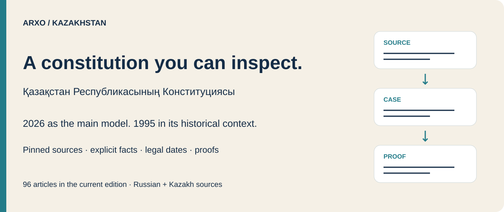
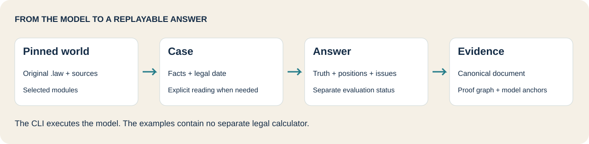
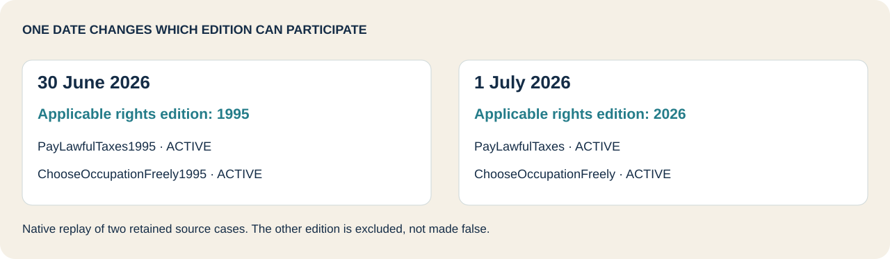
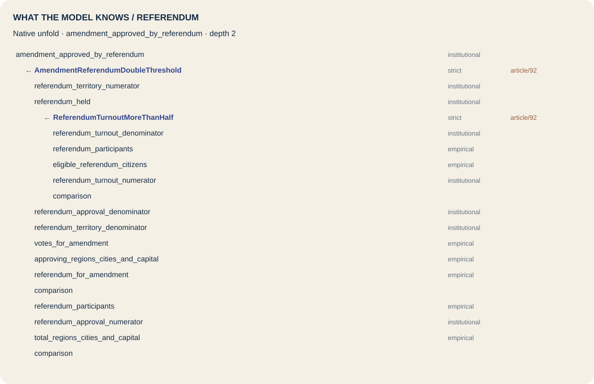

# Arxo Kazakhstan

Explore the **2026 Constitution of Kazakhstan** through executable questions, explicit facts, legal dates and inspectable proofs. The **1995 Constitution** has a separate historical guide and examples.

This is a research demonstration of a pinned formalization. Russian and Kazakh source copies are retained; English explanations are unofficial. Article coverage, executable depth and successful cases are different measures.

[Run a question](#run-a-question) · [Choose a module](#choose-a-module) · [Examples](#explore-the-examples) · [Historical 1995](historical/README.md) · [Inspect evidence](#inspect-evidence) · [Depth and limits](#depth-and-limits) · [Verification](#verification)

## Run a question

Requirements: **Node.js 20+** and Git. The published CLI supports **macOS arm64** and **Linux x86_64**. The models are delivered through GitHub; install the ordinary Arxo CLI through npm:

```sh
npm install -g @arxo/cli@0.2.5
git clone https://github.com/arxohq/arxo-kazakhstan.git
cd arxo-kazakhstan
law eval examples/referendum-passes
```

The fictional referendum has **6 participants out of 10 eligible citizens**, **4 affirmative votes out of 6 participants**, and **14 approving territorial units out of 21**. The model establishes `amendment_approved_by_referendum`: **`COMPUTED` / `TRUE_ONLY`**.

This answers the modeled voting question. It does not establish that every requirement for adopting a constitutional amendment has been met.

Try the turnout boundary:

```sh
law eval examples/referendum-half-turnout
```

Exactly **5 participants out of 10** produces **`COMPUTED` / `NEITHER`**. The positive conclusion is not established; it is not an explicit negative fact.

Both inputs explicitly select `ListItselfEntrenchedReading`, a disputed reading declared by the amendment module for the historical Article 91 issue. This choice remains visible in the case. The mixed-edition module requires a choice even when the question concerns the 2026 referendum. The engine does not choose it for you.

No model npm package, Python runner or separate Kazakhstan CLI is required.

## Choose a module

The main guide follows the 2026 edition. Shared modules also retain historical clauses; **the legal date determines which edition participates**.

| Module | Source | Explore |
|---|---|---|
| **Sources and foundations** — `kz.constitution.sources@0.1.0` | [Source model](packages/sources/constitution.law) | [Official publication](examples/official-publication-required) |
| **Rights and duties** — `kz.constitution.rights@0.1.0` | [Rights model](packages/rights/rights.law) | [Liberties](examples/rights-2026), [edition boundary](examples/edition-after) |
| **President** — `kz.constitution.president@0.1.0` | [President model](packages/president/president.law) | [Timely signature](examples/signature-in-time), [late signature](examples/signature-late) |
| **Kurultai** — `kz.constitution.kurultai@0.1.0` | [Kurultai model](packages/kurultai/kurultai.law) | [Deputy immunity](examples/deputy-immunity) |
| **Government** — `kz.constitution.government@0.1.0` | [Government model](packages/government/government.law) | [Business conflict](examples/government-business-conflict), [teaching exception](examples/government-teaching-exception) |
| **Courts and local government** — `kz.constitution.court@0.1.0` | [Court model](packages/court/court.law) | [Court administers justice](examples/court-administers-justice) |
| **Amendments and transition** — `kz.constitution.amendment@0.1.0` | [Amendment model](packages/amendment/amendment.law) | [Referendum](examples/referendum-passes) |

[Original package CLIR](registry/packages) retains exact model bytes. [Reader worlds](registry/worlds) are native compositions of the selected modules and source package, with every input/output hash recorded. They are execution assemblies, not additional independently published legal models. The internal `linked_audit` world and its added Article 19/41 interpretations are not included.



## Explore the examples

Every [example](examples) contains a self-contained native `request.json`, readable `case.json` and `query.json`, and the saved canonical `result.json`. Most inputs are captured from retained `.lawtest` cases by the released CLI. Additional fictional [reader scenarios](examples/scenarios) demonstrate source rules directly; they are identified separately in the [index](examples/index.json).

| Example | Question or observation | Recorded result |
|---|---|---|
| [Referendum passes](examples/referendum-passes) | Both approval thresholds and turnout satisfied | `COMPUTED` / `TRUE_ONLY` |
| [Exactly half turnout](examples/referendum-half-turnout) | Turnout boundary | `COMPUTED` / `NEITHER` |
| [2026 liberties](examples/rights-2026) | Rights positions in the current edition | `COMPUTED` / `NORM_POSITION` |
| [30 June 2026](examples/edition-before) | Historical rights edition still participates | 1995 positions `ACTIVE` |
| [1 July 2026](examples/edition-after) | Current rights edition participates | 2026 positions `ACTIVE` |
| [Signature in time](examples/signature-in-time) | Law signed within one calendar month | `COMPUTED` / `TRUE_ONLY` |
| [Late signature](examples/signature-late) | Signature after the deadline | `NEITHER`; `POWER_INVALID_EXERCISE` |
| [Deputy immunity](examples/deputy-immunity) | No exception established | `DeputyPersonalImmunity` / `ACTIVE` |
| [Caught at the scene](examples/deputy-caught-at-scene) | An exception defeats protection | That immunity position is absent |
| [A court handles the case](examples/court-administers-justice) | Institutional conclusion about justice | `COMPUTED` / `TRUE_ONLY` |
| [Government business conflict](examples/government-business-conflict) | Member conducts entrepreneurial activity | `COMPUTED` / `TRUE_ONLY` |
| [Teaching exception](examples/government-teaching-exception) | Permitted teaching and a paid position | `COMPUTED` / `NEITHER` |
| [Missing evidence](examples/fact-missing) | Entrepreneurial activity was not supplied | `COMPUTED` / `NEITHER` |
| [Conflicting evidence](examples/fact-conflict) | Explicit positive and negative assertions | `COMPUTED` / `BOTH` |
| [Official publication](examples/official-publication-required) | Rights-affecting act is officially published | Modeled application condition established |
| [Historical President](examples/historical-president) | Powers under the 1995 edition | `COMPUTED` / `NORM_POSITION` |
| [Historical Parliament](examples/historical-parliament) | Parliamentary powers under the 1995 edition | `COMPUTED` / `NORM_POSITION` |

```sh
law eval examples/signature-in-time
law eval examples/signature-late
law eval examples/edition-before
law eval examples/edition-after
```



`TRUE_ONLY`, `FALSE_ONLY`, `BOTH` and `NEITHER` distinguish positive evidence, negative evidence, conflict and absence. Evaluation status and truth status are separate. Normative positions additionally have their own statuses, such as `ACTIVE` or `VIOLATED`. Read the document's `issues` as well: a computed query is not a promise that every diagnostic in the world is clear.

## Historical 1995

The [historical guide](historical/README.md) links the retained consolidation, shared historical clauses and two separate models: **`kz.constitution1995.president@0.1.0`** and **`kz.constitution1995.parliament@0.1.0`**.

The retained historical consolidation contains **102 article headings**, including inserted articles and the excluded Article 84 heading. It is not presented as the original unamended text adopted in 1995. Examples use explicit historical dates; changing a label or choosing a historical world does not override the case's legal date.

## Inspect evidence

Replay an answer and inspect its saved canonical document with native commands:

```sh
law eval examples/referendum-passes
law inspect examples/referendum-passes/result.json summary
```

Answers include `resultHash`, proof graph, positions, conflicts and diagnostics. The saved reader inputs are fictional; the engine supplies the computation, not a second evaluator in a helper script.

**Source-link limitation:** the runtime's `sourceAnchors` field is empty in these reader results. Original model anchors and applied rule IDs are preserved, and the native unfold resolves Article 92 source anchors. This is not claimed as successful automatic source-anchor delivery in the evaluation result.

<details>
<summary>Open the native Article 92 unfold tree</summary>



The figure renders the [native unfold document](assets/unfold-referendum.json). It shows potential derivations; the proof graph records what actually happened in a case. The diagram contains no separate implementation of voting thresholds.

Advanced reproduction:

```sh
law engine unfold registry/worlds/amendment.json \
  amendment_approved_by_referendum --clir registry/packages \
  --depth 2 --lang en --json
```

</details>

## Depth and limits

Fresh structural measurement uses the existing `boundaries.depth` classifier. It counts each module's **own nodes**, with source metadata supplied for resolving anchors; provider rules are excluded from per-module counts. The [machine-readable report](reports/formalization-depth.json) contains article-level rows, both languages, both editions, denominators, input hashes and implementation identities.

| Own module, measured against the 2026 Russian edition | `EXECUTABLE` | `ANCHORED` | Other articles outside this module |
|---|---:|---:|---:|
| Sources and foundations | 6 | 7 | 83 retained as `SOURCE_ONLY` |
| Rights | 30 | 1 | 65 |
| President | 11 | 1 | 84 |
| Kurultai | 9 | 1 | 86 |
| Government | 9 | 0 | 87 |
| Courts | 19 | 1 | 76 |
| Amendments | 5 | 2 | 89 |

The denominator is **96 articles** for each 2026 row; modules overlap, so the rows must not be added. The main 2026 assembly measures **89 `EXECUTABLE` / 7 `ANCHORED`**. The full historical assembly measures **82 `EXECUTABLE` / 19 `ANCHORED` / 1 `SOURCE_ONLY`** against the 102 headings of the retained 1995 Russian consolidation. Kazakh-edition measurements are reported separately.

`EXECUTABLE` means a derivation rule is anchored to the article. It does not establish complete formalization of every clause, legal interpretation, implementing statute or factual situation. The depth report is static evidence; runtime checks are reported separately. Ordinary laws, Constitutional Court case law and other Kazakhstan corpus packages are outside this delivery.

The amendment module includes disputed self-entrenchment readings for the historical Article 91 question. The historical President model declares an external judgment channel; these reader examples do not establish coverage of every judgment flow. Source presence and institutional conclusions do not substitute for an authority's assessment.

## Verification

**Delivery checks and historical expectations are separate.** All nine `.law` roots freshly compile to the exact retained package CLIR bytes with the pinned npm CLI. The 17 reader examples are checked through ordinary npm installation and repeated canonical replay.

The addressed original source suites have **138 passing cases and 3 expectation mismatches out of 141**. Two rights cases and one court case expect a forbearance prohibition to stay `ACTIVE` after the prohibited event; CLI 0.2.5 produces `VIOLATED`. Original source tests and expectations are retained unchanged. See [the failures](reports/source-checks.json) and [verification record](reports/verification.json). Passing reader CI does not claim that those original suites all pass.

To repeat only delivery integrity and reader checks:

```sh
node tools/check.mjs
```

Optional maintainer tools verify the exact export and reproduce the native world composition. [Delivery instructions](docs/DELIVERY.md) · [Source pin](source-pin.json) · [Runtime pin](toolchain.lock.json) · [Exact inventory](CANON-MANIFEST.json).

No full corpus or general acceptance gates were run. **`releaseVerified: false`; corpus `not_checked`.** A model npm package and MCP deployment are not part of this release.

## Sources and license

Source copies were pinned from the [official President website](https://www.akorda.kz/ru/konstituciya-respubliki-kazahstan-3053339) and [Әділет](https://adilet.zan.kz/rus/docs/K950001000_). [Source provenance](packages/sources/sources/constitution/README.md) records the four language/edition copies and their hashes. Extracted texts are `PINNED_UNOFFICIAL_COPY`, not authenticated bytes of printed official publication. Older source notes are retained as historical evidence, not fresh acceptance of every statement.

Arxo model code and delivery tools: **Apache-2.0**. Official texts and publisher material have their own provenance; [NOTICE](NOTICE) distinguishes them. English explanations and model outputs are not official translations or authoritative legal determinations.
